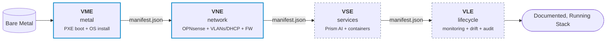

# Velocitee Vector

[](https://github.com/velocit-ee/core/actions/workflows/ci.yml)
[](https://github.com/velocit-ee/core/releases)
[](LICENSE)
[](https://www.python.org/)

**The open-source engine stack behind [velocit.ee](https://velocit.ee). Takes infrastructure from bare metal to a documented, running sovereign stack — engine by engine.**

---

## 1. What It Does

Velocitee Vector is a suite of four independent, composable automation engines. Each engine is single-purpose, fully idempotent, and writes a standardized handoff manifest (`manifest.json`) that downstream engines consume.

Operators can enter the pipeline at **any** infrastructure maturity stage: bare metal, an existing hypervisor, or a running production network.



<!-- ENGINE-STATUS:BEGIN region=engine-table -->
| Engine  | Phase | Status  | Description |
|---------|:-----:|---------|-------------|
| **VME** | 1     | Alpha   | Bare-metal provisioning — PXE boot + unattended OS install (Proxmox VE, Ubuntu Server). Two backends: `builtin` seed stack or `maas` (optional). |
| **VNE** | 2     | Alpha   | Network configuration — OPNsense VM, VLANs, DHCP, DNS, firewall. Two working backends via the renderer registry. Discovery + Path B (`vne join`) for existing networks. |
| VSE     | 3     | Planned | Services — containerised stack deployment, idempotent configuration, and sovereign AI cleanrooms (Velocitee Prism) |
| VLE     | 4     | Planned | Lifecycle — monitoring, drift detection, tamper-evident SHA-256 audit ledger, and single-command repair |
<!-- ENGINE-STATUS:END region=engine-table -->

The engines are named according to their role in the Vector ecosystem:
* **VME (Vector Metal Engine):** Bare-metal provisioning over PXE (builtin seed stack or Canonical MAAS). Drives unattended installation of Proxmox VE or Ubuntu Server.
* **VNE (Vector Network Engine):** Declarative network orchestration. Two paths: `deploy` (provisions OPNsense VM, VLANs, DHCP, DNS, and firewall on Proxmox) or `join` (read-only discovery and non-invasive integration with existing network gateways).
* **VSE (Vector Services Engine):** Deploys containerized services and sovereign privacy cleanrooms, including the [Velocitee Prism](./vector/telia/target/prism) multilingual AI cleanroom.
* **VLE (Vector Lifecycle Engine):** Telemetry, configuration drift detection, auto-documentation, and cryptographic SHA-256 / HMAC audit hash-chain verification.

---

## 2. Modular & Independent Execution

Instructions and workflows are **not** restricted to starting from bare metal. Because each module is decoupled and communicates via standard schemas, you can invoke individual modules as needed:

### Scenario A: Bare-Metal Provisioning from Scratch (VME)
If you are bootstrapping unconfigured bare-metal servers:
```bash
# Guided configuration wizard
vector metal setup

# Verify local seed machine dependencies (DHCP/TFTP/HTTP)
vector metal preflight

# Power on the target hardware for automated PXE netboot
vector metal deploy
```

### Scenario B: Existing Hypervisor or Proxmox Node (VNE Deploy)
If your bare-metal server is already provisioned and running Proxmox VE:
```bash
# Generate declarative network intent (velocitee.yml) from an existing VME manifest
vector network setup --manifest /path/to/vme-manifest.json

# Deploy and verify OPNsense VM, VLAN segmentation, and firewall rules
vector network deploy --config velocitee.yml
```

### Scenario C: Existing Production Network & Router (VNE Join)
If you already have an existing network and router (OPNsense, UniFi, Cisco, or unmanaged gateway):
```bash
# Discover network topology, identify gateway, and generate handoff manifest (read-only)
vector network join
```

### Scenario D: Sovereign AI & Services Deployment (VSE)
Deploy containerized workloads and sovereign AI cleanrooms onto active nodes:
```bash
# Deploy Velocitee Prism sovereign AI cleanroom
vector services deploy --profile prism --target 192.168.8.200

# Inspect active edge services
vector services status --target 192.168.8.200
```

### Scenario E: Lifecycle, Audit & Drift Monitoring (VLE)
Verify cryptographic audit trails and monitor configuration consistency:
```bash
# Verify the append-only SHA-256 audit hash-chain ledger on the gateway
vector lifecycle audit --gateway http://192.168.8.1:8088

# Check edge node hardware telemetry and VLAN mappings
vector lifecycle telemetry --gateway http://192.168.8.1:8088

# Detect configuration drift against declared intent
vector lifecycle drift --config velocitee.yml
```

---

## 3. Unified Command-Line Interface (`vector` / `velocitee`)

The core distribution provides a unified CLI (`vector`, also accessible as `velocitee`), as well as standalone engine binaries (`vme`, `vne`, `velocitee-discover`):

```
Usage: vector [OPTIONS] COMMAND [ARGS]...

Commands:
  status     Show overall status of the Vector pipeline, engines, and manifests.
  discover   Discover network topology, active devices, and gateway routers.
  run        Run an individual engine module independently by name.
  metal      Vector Metal Engine (VME) — setup, preflight, deploy, status, reset.
  network    Vector Network Engine (VNE) — deploy, join, setup, verify.
  services   Vector Services Engine (VSE) — deploy, status, profiles.
  lifecycle  Vector Lifecycle Engine (VLE) — audit, telemetry, drift.
```

---

## 4. Ecosystem & Platform Alignment

Velocitee Vector operates as a coordinated platform:

1. **Carrier Infrastructure Rails (Vector Gateway — Rust):**
   * Statically compiled sub-1MB binary running natively on OpenWrt / CPE routers (GL-AXT1800, Telia X2).
   * Enforces kernel-level zero-trust port quarantine (VLAN 999), constant-time HMAC-SHA256 claim token validation, and single-use iPXE staging.
   * Codenames: **v1.0.0 Alder** (Current), **v2.0.0 Birch** (Future).
   * Repository: [`velocit-ee/vector-gateway`](https://github.com/velocit-ee/vector-gateway).

2. **Sovereign Intelligence (Velocitee Prism — Python):**
   * Sovereign AI privacy cleanroom running on provisioned edge nodes (`:8081`).
   * High-accuracy multilingual PII scrubbing (EN/ET/FI/SV), enterprise company profiles, and Nous Hermes Agent proxy (OpenAI `/v1/chat/completions` + Model Context Protocol).
   * Codenames: **v1.0.0 Aronia** (Prototype), **v2.0.0 Bilberry** (Current production).
   * Package: [`core/vector/telia/target/prism`](./vector/telia/target/prism).

3. **Core Engine Stack (VME, VNE, VSE, VLE — Python):**
   * Independent, composable Python modules packaged as a single installable distribution.
   * Repository: [`velocit-ee/core`](https://github.com/velocit-ee/core).

---

## 5. Project Status & Test Verification

| Category | Metric |
| :--- | :--- |
| **Automated Tests** | **397 passing** across shared, VME, VNE, Prism, and CLI suites |
| **Test Framework** | `pytest` with coverage across schema validation, REST clients, pipeline state, and CLI commands |
| **Static Analysis** | Clean under `ruff check .` with zero lint warnings |
| **Physical Hardware Gate** | 10/10 end-to-end acceptance tests verified on live edge hardware (`./harness/run.sh verify`) |

To execute the complete test suite locally:
```bash
python -m pytest
```

---

## 6. Installation & Development

```bash
# Clone the repository
git clone https://github.com/velocit-ee/core.git
cd core

# Create and activate virtual environment (Python 3.11+ required)
python3 -m venv .venv
source .venv/bin/activate

# Install distribution with development dependencies
pip install -e '.[dev]'

# Verify test suite
pytest
```

---

## 7. Licensing & Open Core

The core engine stack is licensed under the [Apache License, Version 2.0](LICENSE).

* **Open-Source Freedom:** Free for self-hosted private and commercial infrastructure, modifiable, and redistributable with attribution.
* **Carrier & Enterprise Offerings:** Carrier-grade gateway firmware ([Vector Gateway](https://github.com/velocit-ee/vector-gateway)), hardware-enforced kernel quarantine drivers, and enterprise fleet management controllers are licensed under proprietary commercial terms.
* **Contributor Agreement:** All contributions submitted via pull requests are governed by the [Contributor License Agreement](CLA.md). See [CONTRIBUTING.md](CONTRIBUTING.md) for details.
