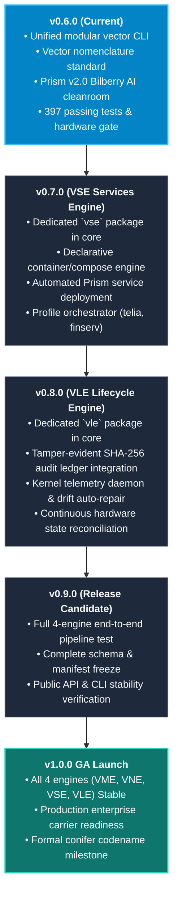

# Velocitee Vector: Engineering Roadmap & Release Architecture

This document establishes the milestone trajectory, feature progression, and botanical naming framework guiding development from the current **`v0.6.0`** release to the **`v1.0.0` General Availability (GA)** launch.

---

## 1. Release Philosophy: The 1.0.0 Stability Commitment

Velocitee follows strict Semantic Versioning (`MAJOR.MINOR.PATCH`). 

**`v1.0.0` will be cut only when all four foundational Vector engines (VME, VNE, VSE, VLE) are 100% complete, feature-complete, and verified stable.**

Pre-1.0 releases (`0.x.y`) represent iterative milestone deliveries that expand the platform's modular capabilities while maintaining backward compatibility for existing manifests and configurations.

---

## 2. Botanical & Scientific Taxonomy Framework

The platform adheres to a scientifically grounded taxonomic hierarchy based on **Vascular Plants (*Tracheophyta*)**:

```
                       KINGDOM PLANTAE (TRACHEOPHYTA)
                                     │
     ┌───────────────────────────────┴───────────────────────────────┐
     ▼                                                               ▼
GYMNOSPERMAE (Conifers / Softwoods)                     ANGIOSPERMAE (Flowering / Broadleaf)
Foundational Evergreen Base                             Structural Rails & Fruit-Bearing Flora
     │                                                               │
     │                                     ┌─────────────────────────┴─────────────────────────┐
     ▼                                     ▼                                                   ▼
OPEN-SOURCE CORE                   CARRIER GATEWAY RAILS                               SOVEREIGN PRISM
Ancient, deep-rooted,              Dense hardwood timber; fast,                        Wild understory berries;
resilient foundation everywhere    kernel-enforced network rails                       blooming AI privacy cleanrooms
(e.g., Fir, Pine, Cypress, Cedar)  (e.g., Alder, Birch, Chestnut)                      (e.g., Aronia, Bilberry, Cloudberry)
```

### A. Open-Source Core $\rightarrow$ Gymnosperms / Conifers (*Pinophyta*)
Deep-rooted evergreen timber providing permanent structural support across all environments.
* **v1.0.0: Arolla** (*Pinus cembra* — Arolla Pine / Swiss Stone Pine: iconic high-alpine conifer renowned for extreme longevity and cold-hardiness).
* **v2.0.0: Balsam** (*Abies balsamea* — Balsam Fir).
* **v3.0.0: Cedar** (*Cedrus* — Mountain Cedar).
* **v4.0.0: Douglas** (*Pseudotsuga menziesii* — Douglas Fir).
* **v5.0.0: Engelmann** (*Picea engelmannii* — Engelmann Spruce).

### B. Carrier Edge Rails $\rightarrow$ Deciduous Hardwood Trees (*Angiospermae*)
* **v1.0.0: Alder** (*Alnus glutinosa* — Water-resistant, rot-proof hardwood used for bridge piles; native Rust daemon on OpenWrt).
* **v2.0.0: Birch** (*Betula pendula* — Iconic silver Nordic hardwood; planned v2.0 carrier gateway).
* **v3.0.0: Chestnut** (*Castanea sativa*).
* **v4.0.0: Dogwood** (*Cornus*).
* **v5.0.0: Elm** (*Ulmus*).

### C. Sovereign Intelligence $\rightarrow$ Wild Nordic Berries (*Ericaceae & Rosaceae*)
* **v1.0.0: Aronia** (*Aronia melanocarpa* — Nordic dark chokeberry; initial proof-of-concept).
* **v2.0.0: Bilberry** (*Vaccinium myrtillus* — Iconic wild Nordic purple berry matching Telia's purple brand; active production hub).
* **v3.0.0: Cloudberry** (*Rubus chamaemorus* — Rare Arctic amber berry; planned multi-node sovereign fleet).
* **v4.0.0: Dewberry** (*Rubus caesius*).
* **v5.0.0: Elderberry** (*Sambucus nigra*).

---

## 3. Milestone Trajectory: Path to v1.0.0



---

### Detailed Milestone Objectives

#### `v0.6.0` — Current Release (Completed)
- [x] Unified `vector` and `velocitee` CLI entrypoints in `shared.vector_cli`.
- [x] Independent execution for `vector metal`, `vector network`, `vector services`, `vector lifecycle`, `vector discover`, and `vector run <module>`.
- [x] Vector nomenclature alignment across code, docs, and JSON schemas.
- [x] Historical changelog restructuring across milestones `v0.1.0` through `v0.6.0`.
- [x] 397 unit/integration tests passing; 10/10 live hardware gates passing.

#### `v0.7.0` — Vector Services Engine (VSE)
*Goal: Transform VSE from a planned specification into a fully implemented, standalone engine package.*
- [ ] Create `core/vse/` package structure matching `vme/` and `vne/`.
- [ ] Implement declarative service intent schema (`VSEIntent` in `shared/schema.py`) supporting containerized stacks (Docker Compose / Podman) and edge native daemons.
- [ ] Implement automated deployment and lifecycle hooks for **Velocitee Prism v2.0** on provisioned targets.
- [ ] Add CLI commands: `vector services deploy`, `vector services status`, `vector services restart`, and `vector services profiles`.
- [ ] Comprehensive unit test suite in `vse/tests/`.

#### `v0.8.0` — Vector Lifecycle Engine (VLE)
*Goal: Implement continuous monitoring, cryptographic audit verification, and automated drift self-healing.*
- [ ] Create `core/vle/` package structure.
- [ ] Real-time verification of the append-only SHA-256 / HMAC audit hash-chain ledger across router gateway and edge nodes.
- [ ] Automated drift detection comparing declared `velocitee.yml` intent against live Proxmox VM states, OPNsense firewall tables, and target services.
- [ ] Automated drift remediation (`vector lifecycle repair`).
- [ ] Integration with RFC 5424 syslog sinks.

#### `v0.9.0` — Release Candidate (Feature Freeze)
- [ ] End-to-end integration proving the full automated pipeline: Bare Metal (VME) $\rightarrow$ Network (VNE) $\rightarrow$ Services (VSE) $\rightarrow$ Lifecycle (VLE) without human intervention.
- [ ] Validation of join-mode and hybrid workflows where operators enter at Phase 2, 3, or 4.
- [ ] Schema freeze for `manifest.json` v1.0 and `velocitee.yml` v1.0.

#### `v1.0.0` — General Availability (GA Launch)
- [ ] All four engines promoted to **Stable** in `engines.json`.
- [ ] Long-term backward compatibility commitment for all public CLI interfaces and manifest formats.
- [ ] Complete documentation published at `docs.velocit.ee`.
- [ ] Codename: **Arolla** (*Pinus cembra* — Arolla Pine, Conifer).
